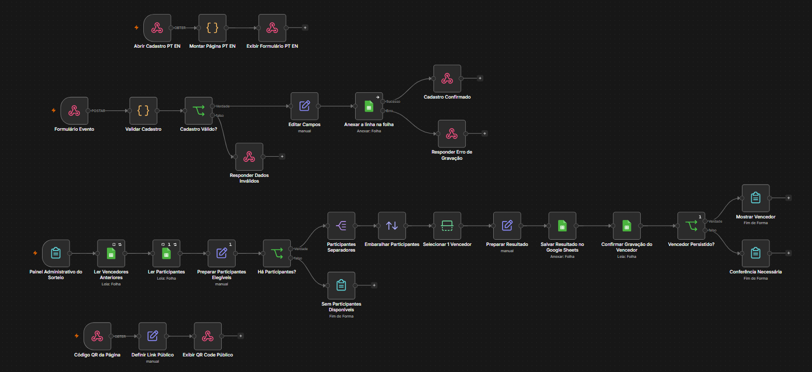
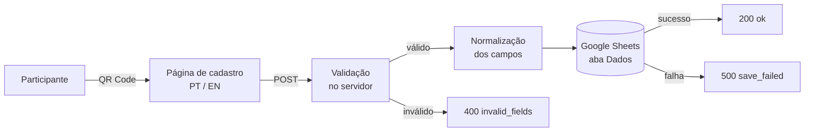
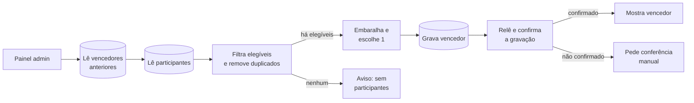

# Cadastro e Sorteio de Evento com n8n

Sistema completo para eventos presenciais construído em um único workflow n8n: página de cadastro bilíngue, QR Code para os participantes, armazenamento em Google Sheets e um painel de sorteio que nunca premia a mesma pessoa duas vezes.

## Problema

Em eventos, o cadastro de participantes costumava ser feito em papel ou em formulários genéricos, sem validação, sem registro de consentimento e com sorteios feitos à mão, sujeitos a erro e a premiar a mesma pessoa mais de uma vez.

## Solução

Um único workflow com quatro entradas independentes:

| Entrada | O que faz |
|---|---|
| `GET /webhook/cadastro-evento` | Gera e exibe a página de cadastro em **português e inglês** |
| `POST /webhook/cadastro-evento-enviar` | Recebe o envio, valida no servidor e grava na planilha |
| `GET /webhook/evento-qr` | Exibe uma página com o QR Code que leva ao cadastro |
| `/form/sorteio-admin` | Painel da organização para realizar os sorteios |

### Cadastro

### Sorteio

## Destaques técnicos

- **Página bilíngue gerada pelo próprio n8n** (nó Code), com troca de idioma sem recarregar, campos condicionais ("Outro") e seleção múltipla.
- **Validação dupla:** no navegador e de novo no servidor, comparando cada resposta com a lista de opções permitidas. O formulário não confia no que chega do cliente.
- **Aviso de privacidade (LGPD)** recolhível, com consentimento obrigatório e registro de data e versão do aviso.
- **Sorteio justo e auditável:** descarta cadastros inválidos, remove duplicados por e-mail e telefone (normalizando `+55`), exclui quem já ganhou e grava o resultado na planilha.
- **Confirmação de gravação:** depois de salvar o vencedor, o fluxo relê a planilha e só mostra o resultado se o registro foi confirmado, evitando sorteios "fantasmas".
- **Tratamento de erros:** respostas HTTP distintas para dado inválido (400) e falha de gravação (500), com mensagens claras ao participante.
- **QR Code dinâmico:** a URL do cadastro é derivada da própria URL do webhook, então o fluxo funciona em qualquer instância sem ajuste manual.

## Tecnologias

Nós utilizados: Webhook · Code · IF · Set · Respond to Webhook · Form Trigger · Form · Google Sheets · Split Out · Sort · Limit

## Como usar

1. No n8n, abra **… → Import from File** e selecione `workflow.json`.
2. Crie uma planilha no Google Sheets com duas abas:
   - **Dados:** `Nome`, `E-mail`, `Telefone`, `Cargo`, `Empresa`, `Situacao projeto`, `Previsao aquisicao`, `Tecnologias projeto`, `Fonte recurso`, `Apoio tecnico`
   - **Resultados:** `Status`, `Nome`, `E-mail`, `Telefone`, `Cargo`, `Empresa`
3. Configure a credencial do Google Sheets nos nós de planilha e selecione sua planilha e as abas (o arquivo vem com `ID_DA_PLANILHA` como marcador).
4. Troque as imagens de `example.com/imagens/...` pelas URLs dos seus logos.
5. Ajuste o texto do aviso de privacidade com os dados da sua empresa.
6. Ative o workflow e abra `/webhook/evento-qr` para exibir o QR Code no evento.

> Os dados de empresa, planilha, imagens e credenciais foram substituídos por marcadores fictícios.
